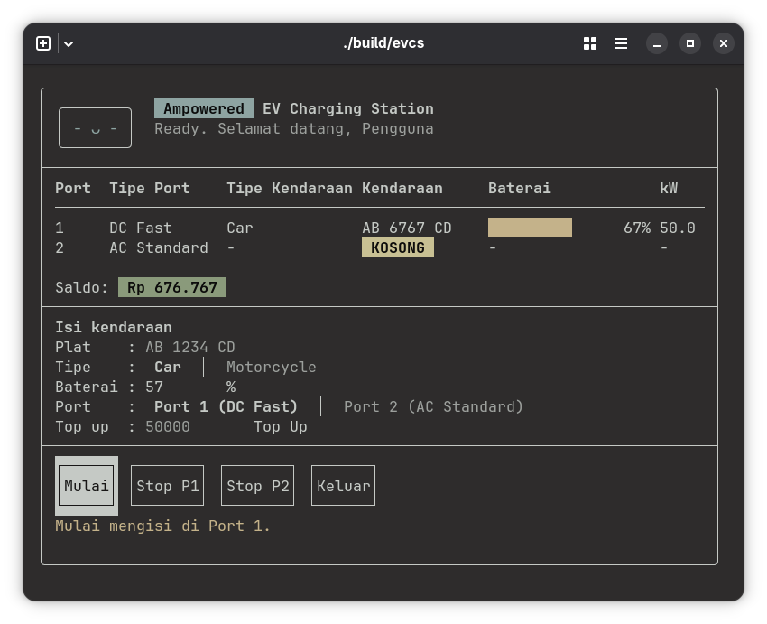

# Ampowered - EV Charging Station System

Simulasi stasiun pengisian daya kendaraan listrik (EV) berbasis *Terminal User Interface* (TUI), dibuat dengan C++ dan [FTXUI](https://github.com/ArthurSonzogni/FTXUI). Proyek ini dibuat untuk mendemonstrasikan empat pilar Object-Oriented Programming (OOP).
<p align="center">
  
</p>

## Anggota Kelompok
* **Muhammad Affriza Ayman Nashmi** - 25/559828/TK/63201
* **Fawaz Rizky Darmawan** - 25/559930/TK/63218

## Fitur Utama
* **Simulasi waktu pengisian**: persen baterai, laju pengisian, dan biaya berubah seiring waktu simulasi (1 detik nyata = 1 menit simulasi).
* **Dua jenis kendaraan dan port**: `Car` dan `Motorcycle` dengan laju pengisian yang turun saat baterai hampir penuh; `DCFastPort` (Rp3.500/kWh) dan `ACStandardPort` (Rp2.000/kWh).
* **Saldo pengguna**: biaya dihitung dari energi yang benar-benar masuk ke baterai, dengan fitur *top up*. Sesi berhenti otomatis saat biaya mencapai saldo.
* **Antarmuka terminal interaktif**: tabel status port, bar baterai berwarna, dan form input dengan validasi angka.

## Prerequisites
* Compiler C++ yang mendukung C++17 (GCC 8+ / Clang 7+ / MSVC 2019+)
* [CMake](https://cmake.org/) 3.14 atau lebih baru
* Git
* Koneksi internet saat build pertama (FTXUI v7.0.3 diunduh otomatis dengan CMake `FetchContent`)
* Terminal dengan dukungan Unicode dan ukuran jendela yang cukup besar agar seluruh panel terlihat

## Build dan Menjalankan
```bash
git clone https://github.com/friz-ssh/ampowered.git
cd ampowered

cmake -S . -B build
cmake --build build

./build/evcs
```

## Cara Pakai
1. Tunggu layar peluncuran selesai (sekitar 2,5 detik).
2. Isi plat nomor, pilih jenis kendaraan, isi persen baterai awal, dan pilih port.
3. Pilih tombol **Mulai**. Baris port pada tabel akan terisi dan baterainya naik.
4. Tekan **Stop** pada port terkait untuk menghentikan dan membayar, atau tunggu sesi berhenti otomatis saat saldo habis.
5. Isi nominal **Top Up** untuk menambah saldo.

Navigasi: `Tab` / panah untuk berpindah, panah kiri-kanan untuk mengganti pilihan, `Enter` untuk menekan tombol.

## Implementasi 4 Pilar OOP
1. **Encapsulation**: atribut seperti `balance` pada `User` dan `currentCharge` pada `Vehicle` bersifat `private` dan hanya berubah lewat metode yang menjaga aturan, yaitu `deductBalance()`, `topUp()`, dan `injectEnergy()`.
2. **Abstraction**: `Vehicle` dan `ChargingPort` adalah kelas abstrak yang hanya mendefinisikan kontrak. `ChargingSession` menyederhanakan proses pengisian menjadi `simulateTime()` dan `stopSession()`, dan `makeVehicle()` menyembunyikan kelas konkret yang dibuat.
3. **Inheritance**: `Car` dan `Motorcycle` mewarisi `Vehicle`; `DCFastPort` dan `ACStandardPort` mewarisi `ChargingPort`.
4. **Polymorphism**: fungsi *pure virtual* (`calcChargeSpeed()`, `getType()`, `getRatePerKwh()`, `getTypeName()`) di-*override* oleh kelas turunan, sehingga berbagai kendaraan dan port diproses seragam lewat *pointer* kelas dasar. Terdapat juga *overload* `ChargingSession::simulateTime(double)` dan `simulateTime(int)`.

## Batasan
* Waktu simulasi dipercepat dan tidak *real time*.
* Tidak ada pengecekan kendaraan (plat dan jenis) yang pernah diisi; setiap pengisian membuat objek kendaraan baru.
* Satu pengguna, dua port, tanpa penyimpanan permanen.

## Struktur Direktori
```
.
├── .gitignore
├── CMakeLists.txt
├── README.md
├── include
│   ├── App.hpp
│   ├── ChargingPort.hpp
│   ├── ChargingSession.hpp
│   ├── TuiStyle.hpp
│   ├── User.hpp
│   └── Vehicle.hpp
└── src
    ├── App.cpp
    ├── ChargingPort.cpp
    ├── ChargingSession.cpp
    ├── main.cpp
    ├── TuiStyle.cpp
    ├── User.cpp
    └── Vehicle.cpp
```